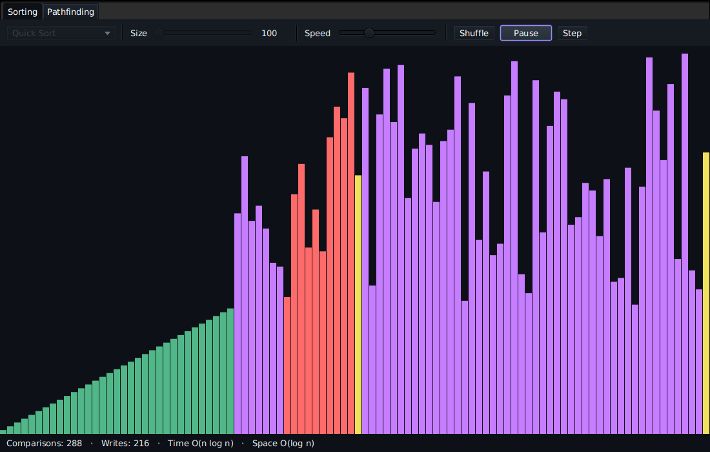
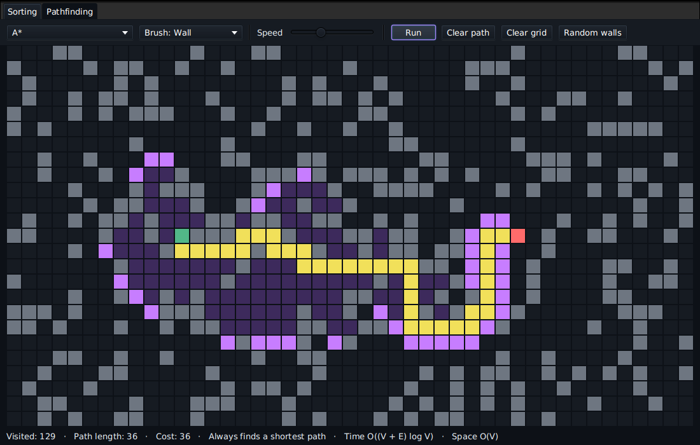

# 🧠 Algorithm Visualizer

An interactive JavaFX app that animates sorting and pathfinding algorithms step by step, so you can watch how they work and compare them side by side.





---

## ⚙️ Features

### Sorting
- **Bubble Sort**, **Merge Sort** and **Quick Sort** (median-of-three pivot)
- Arrays from 10 up to **10,000 elements**
- Live **comparison and write counters**, plus each algorithm's time and space complexity
- Play, pause, single-step and a speed control (1 to ~5,000 steps per frame)
- Colors: 🟨 comparing, 🟥 writing, 🟩 in final position

### Pathfinding
- **Breadth-First Search**, **Depth-First Search**, **Dijkstra** and **A\***
- Drag to draw walls or **weighted cells** (cost ×5), and right-drag to erase
- Drag the 🟩 start and 🟥 end to move them, or generate random walls
- Shows cells visited, path length, path cost, and whether the algorithm guarantees a shortest path

| Algorithm | Shortest path? | Uses weights? | Time |
|---|---|---|---|
| BFS | ✅ fewest steps | ❌ | O(V + E) |
| DFS | ❌ | ❌ | O(V + E) |
| Dijkstra | ✅ cheapest | ✅ | O((V + E) log V) |
| A\* | ✅ cheapest | ✅ | O((V + E) log V) |

---

## 🧩 How it works

- **Algorithms know nothing about the UI.** Sorting algorithms work on a `TrackedArray`, and pathfinding algorithms report to a `SearchListener`. Both emit events like *compare*, *swap* or *visit*, which makes the algorithms easy to unit test.
- **`StepPlayer`** runs the algorithm on a background thread and pushes its steps into a small bounded queue. A JavaFX `AnimationTimer` drains that queue a few steps per frame. When the algorithm gets ahead of the animation it just blocks, so memory stays flat even for millions of steps (bubble sort on 10,000 elements).
- **Shared test contracts** (`SortingAlgorithmContract`, `PathfindingAlgorithmContract`) run the same checks against every algorithm. Pathfinding results are checked against BFS and a brute-force Bellman-Ford on hundreds of random grids.

---

## 🛠 Tech Stack

- **Language:** Java 21 ☕
- **UI:** JavaFX 21 (Canvas rendering)
- **Build & tests:** Maven, JUnit 5
- **CI:** GitHub Actions runs `mvn verify` on every push and pull request

---

## 🧭 Usage

Requires **JDK 21+** and **Maven**.

```bash
# Clone the repository
git clone https://github.com/RininAbraham1/algorithm-visualizer.git
cd algorithm-visualizer

# Run the app
mvn javafx:run

# Run the tests
mvn test
```

---

## 📁 Project Structure

```
src/main/java/com/rinin/algoviz/
├── App.java              # window with Sorting and Pathfinding tabs
├── sorting/              # BubbleSort, MergeSort, QuickSort, TrackedArray
├── pathfinding/          # Grid, BFS, DFS, Dijkstra, AStar
└── ui/                   # SortingView, PathfindingView, StepPlayer
```
